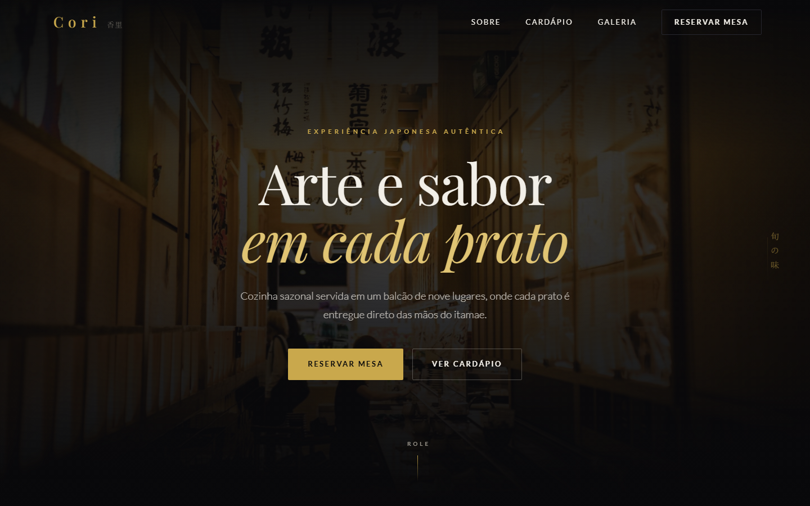

# Cori — cozinha japonesa

Site conceito de restaurante japonês, responsivo, com reserva de mesa e galeria de fotos.

**[▶ Ver o site ao vivo](https://kaynanfrontend.github.io/Projeto-Cori/)**

## Sobre
Site conceito de uma página para um restaurante japonês com cozinha sazonal, balcão de sushi e omakase. Mostra pratos, galeria e um formulário de reserva, e se adapta do celular ao desktop.

Tipo: Projeto conceito

## Tecnologias
- HTML5
- CSS3
- JavaScript

## Destaques
- Formulário de reserva com validação campo a campo, bloqueio de datas passadas, estado de carregamento e confirmação
- Galeria com lightbox acessível, que mantém o foco dentro dela e fecha ao clicar no fundo
- Scrollspy que marca no menu a seção sendo lida, revelação de conteúdo ao rolar e menu mobile
- Imagens otimizadas em WebP com `loading="lazy"` e respeito a `prefers-reduced-motion`

---
Feito por **Kaynan Ribeiro de Sousa** · [musgoestudio.com](https://musgoestudio.com)
